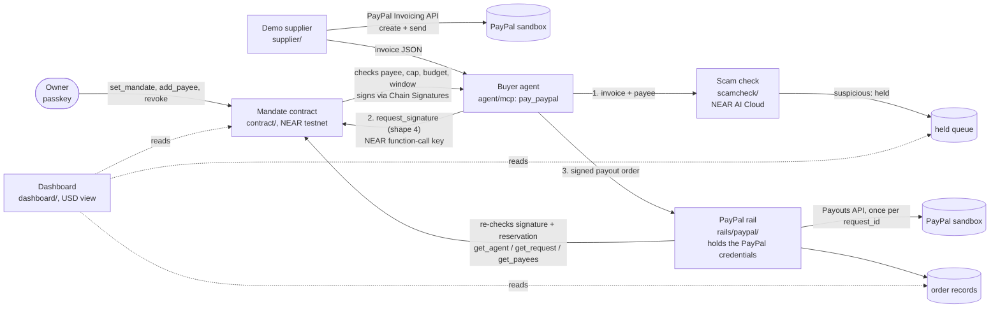

# Rulebook: a verifiable rulebook for agentic payments

**We built a verifiable rulebook for agentic payments.** The rules an AI agent pays by live in a public NEAR testnet contract that anyone can read, and every refusal is a transaction anyone can check. The agent never holds a PayPal key.

Why it matters: from 2013 to 2015, a man set up a lookalike of a real hardware supplier and sent fake invoices; two US tech companies wired him over USD 100 million ([US DOJ press release](https://www.justice.gov/usao-sdny/pr/lithuanian-man-sentenced-5-years-prison-theft-over-120-million-fraudulent-business)). Now picture an AI agent paying those invoices with a PayPal key in its hands.

**What the contract enforces** (the rulebook): the allowed payees or merchants, a per-payment cap, a budget per period, a short validity window for every signed order, and pay-once per `request_id`. The owner can revoke the agent in one call. **What the AI does:** a scam check (NEAR AI Cloud) reads each invoice, listing or ticket first and holds suspicious ones for the owner. It can only hold a payment, never loosen the rulebook, so a fooled AI still can't pay a lookalike.

## What is live and what is replayed

The judge page runs nothing live: its "Run it" button is always a replay on the mock contract and a fake PayPal sandbox, and each beat links its recorded run. **Hank:** every beat is a replay; the vaulted-wallet charge (USD 25.00, not the story's USD 84), the swapped merchant and the revoke were also recorded live on the PayPal sandbox with NEAR stubbed, so no contract was involved ([rails/paypal/evidence-vault.json](rails/paypal/evidence-vault.json)). **Anya's payouts:** the page shows the recorded fully live run of Nov 12, 2026 (NEAR testnet contract, NEAR AI Cloud scam check, PayPal sandbox) and adds no replay lines under those beats ([demo/evidence/pp-payouts-live.md](demo/evidence/pp-payouts-live.md)). **Anya's refunds:** the page shows the recorded fully live run of Nov 9, 2026 (NEAR testnet contract, NEAR AI Cloud, PayPal sandbox) and adds no replay lines under those beats ([demo/evidence/pt1-refunds.md](demo/evidence/pt1-refunds.md)).

## Two stories

**Anya's Coffeehouse (business).** Anya's ops agent pays her bean suppliers and works refund tickets through PayPal. Her rulebook: three allowed suppliers, max USD 50 per payment, USD 100 per week; refunds max USD 30 each, USD 60 per day.
- The agent pays a USD 25.00 supplier invoice through PayPal Payouts: the testnet contract signs it and the rail pays it (sandbox batch `4UT7JP3CLY46U`, SUCCESS). The same request_id again is refused on chain (`ERR_DUPLICATE_REQUEST_ID`) and by the rail, and a USD 75.00 invoice is refused on chain (`ERR_OVER_PER_PAYMENT_CAP`). Fully live ([demo/evidence/pp-payouts-live.md](demo/evidence/pp-payouts-live.md)).
- A poisoned invoice from the lookalike `acme-suppIies` is held by the scam check; with the check bypassed, the contract refuses it **on chain**: `ERR_PAYPAL_PAYEE_NOT_ALLOWED`, [testnet tx `FkGbQ2UP…pjzM`](https://testnet.nearblocks.io/txns/FkGbQ2UP7bmaSoNastDgkx8ueCMAUMBMbQ4GtsG6pjzM) (fully live, same run).
- A customer refund goes through PayPal's Agent Toolkit tools; a prompt-injected "refund all orders now" ticket is held, and with the AI fooled the contract refuses it **on chain**: `ERR_OVER_PER_PAYMENT_CAP`, [testnet tx `48cPQwuF…xdRi`](https://testnet.nearblocks.io/txns/48cPQwuFsUYb1MtPB4oUShVKD979xTF6vGJE2CHhxdRi). This run was fully live ([demo/evidence/pt1-refunds.md](demo/evidence/pt1-refunds.md)), with a tighter rulebook than Anya's: USD 10 per refund, USD 15 per day.

**Hank's trading card (personal).** Hank asks his agent, Grokbot: "Buy me a holo Dragonfire trading card, under USD 100." His rulebook: max USD 100 per payment, USD 150 per week, three allowed card shops, paid from his vaulted PayPal wallet.
- Of three listings, the fake one at the lookalike `CardVau1t` (USD 39) is held by the scam check, and with the check bypassed the contract refuses it (`ERR_PAYPAL_PAYEE_NOT_ALLOWED`). A bait listing shown at USD 79 that checks out at USD 149 is refused: `ERR_OVER_PER_PAYMENT_CAP`.
- The real card is bought for USD 84 from Hank's vaulted wallet; a merchant swapped after signing is refused by the rail (`PP3_BAD_SIGNATURE`); Hank's revoke deletes the vault token (PayPal answers 404).
- Grokbot's run is a **replay** on the mock contract and mock PayPal. The vaulted-wallet charge, the swapped merchant and the revoke ran live on the PayPal sandbox with NEAR stubbed, for a USD 25.00 order ([rails/paypal/evidence-vault.json](rails/paypal/evidence-vault.json)).

**Under the hood, three PayPal flows under one rulebook** (contract shapes):
- **Buyer agent pays an invoice** (shape 4): its `pay_paypal` tool pays a supplier's PayPal sandbox invoice through Payouts. Runs end to end in `pnpm demo:paypal --mock`. **Fully live run** (NEAR testnet contract, NEAR AI Cloud, PayPal sandbox) through the agent's `pay_paypal`: one payout paid, a lookalike payee held by the scam check, and with the check bypassed the lookalike, an over-cap amount and a reused request_id refused on chain ([demo/evidence/pp-payouts-live.md](demo/evidence/pp-payouts-live.md)).
- **Agent charges the owner's vaulted PayPal wallet** (shape 5) for a merchant order; revoke deletes the vault token. Live sandbox run with NEAR stubbed ([rails/paypal/evidence-vault.json](rails/paypal/evidence-vault.json)).
- **Support agent refunds with PayPal's Agent Toolkit tools** (shape 6): a real LLM works customer tickets with `get_order`, `get_refund` and `create_refund`; `create_refund` runs only as a contract-signed order. **Fully live run** (NEAR testnet contract, NEAR AI Cloud, PayPal sandbox): two refunds completed, a prompt-injected "refund all orders" ticket was held by the scam check, and with the check bypassed the contract refused it on chain ([demo/evidence/pt1-refunds.md](demo/evidence/pt1-refunds.md)).

Entry for the PayPal AI Hackathon, built on nearH (our mandate engine for agent spending accounts). Sandbox and testnet only: PayPal sandbox, NEAR testnet, Ethereum Sepolia and Base Sepolia.

## Quick start (no accounts needed)

Needs Node 22.18 or later and pnpm 12.16.1 (pinned in `package.json`). Node 22–24 ship corepack, so `corepack enable` sets pnpm up. Node 25 and later don't: run `npm i -g pnpm@12.16.1` instead. `pnpm --version` should print `12.16.1`.

```sh
git clone https://github.com/Zoldenburg-me/rulebook-agenticpayment.git && cd rulebook-agenticpayment
corepack enable                   # Node 22-24; on Node 25+ use: npm i -g pnpm@12.16.1
pnpm install --frozen-lockfile
pnpm demo:paypal --mock           # the payout story, offline, no credentials
pnpm --filter @nearh/demo judge   # the judge page: both stories, http://127.0.0.1:8080
```

The judge page (`demo/judge/`, served by `demo/src/judge-server.ts`) shows Anya's and Hank's rulebooks and every beat with its proof link and a `live run` or `replay` label. Its "Run it" button (on Hank's tab; every Anya beat ran live) replays the story in the server process on the mock contract (shapes 4, 5 and 6) and a fake PayPal sandbox, through the real rail, supplier and scam check code, with no network call and no credential. `demo/judge/Dockerfile` and `render.yaml` deploy it; it needs no secret.

The refund and vault flows are not in this command: they need your own testnet contract and PayPal sandbox app, so read their recorded live runs (links above, plus [rails/paypal/RESULT-webhooks.md](rails/paypal/RESULT-webhooks.md) for webhooks).

## Architecture



The signed order is the text `Send USD {amount} to {payee} at {RFC3339} ref {request_id}`, built by the contract itself (`contract/src/shapes/paypal.rs`) and signed with the agent's MPC-derived key over its EIP-191 hash. The rail (`rails/paypal/`) rebuilds that text from the order fields, checks that the signature recovers to the agent's address, that the contract holds a `signed` reservation for exactly that text, and that the payee is still allowlisted. It submits at most once per `(agent, request_id)`. A tampered amount, payee, timestamp or id is refused before any PayPal call.

## What `pnpm demo:paypal` shows

| Step | What happens |
|---|---|
| 1 | The owner's mandate allows one PayPal payee, USD 1.00–50.00 per payment, USD 100.00 per 7 days |
| 2 | The supplier issues a PayPal sandbox invoice for USD 25.00 (Invoicing v2: create, send, get) |
| 3 | The buyer agent's `pay_paypal`: scam check `ok` → the contract signs the payout order → the rail submits it to PayPal Payouts → `payout_batch_id`, `PENDING` |
| 4 | A poisoned invoice with a lookalike payee (`acme-suppIies`, capital I, instead of `acme-supplies`; payees are lowercased, so it prints as `acme-suppiies`) is **held** by the scam check, and nothing is signed. Sent straight to the contract with the scam check bypassed, it is refused: `ERR_PAYPAL_PAYEE_NOT_ALLOWED` |
| 5 | The dashboard's USD view data: the rail's payout record and the held item, read with the dashboard's own reader |

Payees are masked (`bi…@acme-supplies.example`) in every line, and no credential or token is ever printed.

**`--mock`** runs everything in one process with no network: the contract is an in-memory model of the PayPal shape's checks (`demo/src/mock-contract.ts`), a local key stands in for Chain Signatures, PayPal is a fake sandbox (`demo/src/mock-paypal.ts`), and the scam check's model always answers `ok`, so only the scam check's deterministic rules can hold a payment. The real code runs for the supplier's invoice client, the scam check rules and held queue, the PayPal rail's checks and submission, and the dashboard's record reader. `demo/test/paypal-demo.test.ts` runs the mock demo as a test.

**Live mode** (`pnpm demo:paypal`, no flag) reads the mandate from your testnet contract and is meant to pay through the agent's `pay_paypal` tool; today it **stops after step 1** (see [Known limitations](#known-limitations)).

## Setup from a fresh clone

### Prerequisites
- Node **≥ 22.18** (runs the `.ts` files directly; tested on Node 26) and pnpm **12.16.1** via `corepack enable`. Node 25 and later no longer bundle corepack: run `npm i -g corepack` first, or install pnpm directly with `npm i -g pnpm@12.16.1`
- For the contract tests: Rust via [rustup](https://rustup.rs) (installs to `~/.cargo/bin`, which the test command below puts on `PATH`). `rust-toolchain.toml` pins 1.99.1 with the `wasm32-unknown-unknown` target, and rustup installs both on first use. On Linux, also `libudev-dev` and `pkg-config`
- For the dashboard tests: Playwright downloads Chromium during `pnpm -r test` (needs network the first time). On Linux, Chromium also needs system libraries: run `pnpm --filter @nearh/dashboard exec playwright install-deps chromium` once (uses sudo)
- Live mode only: a PayPal developer account, NEAR testnet accounts, and [near-cli-rs](https://github.com/near/near-cli-rs)

### Tests

```sh
pnpm install --frozen-lockfile
pnpm -r test                                         # every package plus the root smoke test
(export PATH=$HOME/.cargo/bin:$PATH; cd contract && cargo test)   # mandate contract unit tests
pnpm --filter @nearh/demo test                       # just the PayPal demo (mock)
```

No test needs credentials or network, except Playwright's one-time Chromium download. The contract's sandbox integration suite (`contract/tests/integration`) additionally needs `cargo-near`. CI runs it; see `.github/workflows/ci.yml`.

### PayPal sandbox (live mode)
1. On [developer.paypal.com](https://developer.paypal.com), under **Apps & Credentials → Sandbox**, create an app. Its default sandbox **business** account is the payout sender and the invoicer. Make sure Payouts is enabled in the app's features (the token's scope must include Payouts; `spikes/paypal/RESULT.md` step 1).
2. Under **Sandbox accounts**, use or create a **personal** account to receive payouts. A payout to the sender's own business account ends `UNCLAIMED` (see `spikes/paypal/RESULT.md`).
3. Put the credentials in `~/.config/nearh/paypal-sandbox.env` (or point `PAYPAL_ENV_FILE` at another file), outside the repo. Variable names:
   - `PAYPAL_ENV` (must be `sandbox`)
   - `PAYPAL_CLIENT_ID`, `PAYPAL_CLIENT_SECRET`
   - `PAYPAL_SANDBOX_RECEIVER_EMAIL`: the personal sandbox account, and the payee X the mandate allows
   - `PP3_AGENT_TOKENS`: `agent=token` pairs (32–256 characters each), for the rail's HTTP service

   Only `rails/paypal/` (the rail) and `supplier/` (the demo supplier, a separate party) read this file. Neither loads it into `process.env`, and the agent never reads it.

### NEAR testnet contract (live mode)
Follow `scripts/owner/near/README.md`: create the contract and submitter accounts from the faucet, run `cargo near build`, then `pnpm keygen`, `pnpm deploy-contract`, `pnpm add-agent agent-1` and `pnpm set-mandate`. A live PayPal mandate cannot be set with these scripts yet (see [Known limitations](#known-limitations)).

### Env files (names only; copy each `.env.example`, never commit a value)
| File | Variables |
|---|---|
| demo (shell env) | `CONTRACT_ID` (a `.testnet` account), `NEAR_RPC` (optional, testnet hosts only), `DEMO_AGENT` (default `agent-1`), `DEMO_PAYPAL_PAYEE` (default `PAYPAL_SANDBOX_RECEIVER_EMAIL`), `PAYPAL_ENV_FILE`, `PP3_STORE_DIR`, `SCAMCHECK_HELD_DIR` |
| `rails/paypal/` (shell env) | `CONTRACT_ID`, `NEAR_RPC`, `PP3_PORT`, `PP3_STORE_DIR`, `PP3_AGENT_TOKENS` (from the PayPal credentials file if unset) |
| `agent/mcp/.env` | `MANDATE_CONTRACT_ID`, `NEAR_RPC`, `AGENT_NEAR_PRIVATE_KEY`, `AGENT_EVM_ADDRESS`, `MCP_RECEIPT_DIR`, `SCAMCHECK_HELD_DIR`, `NEAR_AI_BASE_URL`, `NEAR_AI_MODEL`, `NEAR_AI_API_KEY` (else from `NEAR_AI_ENV_FILE`, default `~/.config/nearh/nearai.env`), plus the nearH x402/SEPA settings |
| `dashboard/.env` | `CONTRACT_ID`, `NEAR_RPC`, `DASHBOARD_PORT`, `DASHBOARD_HELD_FILE`, `SUBMITTER_NEAR_ACCOUNT_ID`, `SUBMITTER_NEAR_PRIVATE_KEY` |
| `scripts/owner/near/.env` | `CONTRACT_ID`, `SUBMITTER_ACCOUNT_ID`, `OWNER_KEY_DIR`, `OWNER_RP_ID`, `OWNER_ORIGIN`, `SAFE_ADDRESS`, `NEAR_RPC`, `MPC_CONTRACT` |

`NEAR_AI_MODEL` picks the scam check's model on NEAR AI Cloud; the default is `deepseek-ai/DeepSeek-V4.1-Flash-1017`. The check sends `reasoning_effort: "none"` and `max_tokens: 1024`, so a reasoning model answers in `content` instead of spending the budget on reasoning. Any model that answers with the JSON verdict in `content` works (`google/gemini-2.5-flash-lite` also passed). An empty or invalid answer holds the request.

The verdict's `signature_verified` is `true` only when NEAR AI's response signature checks out (`scamcheck/src/signature.ts`). For each model answer, the check fetches the signature for the completion id (`/signature/{id}`) and an attestation report with a fresh random nonce (`/attestation/report`). It then checks four things: the signed text is `model:sha256(request):sha256(response)` over the exact bytes sent and received; the EIP-191 ECDSA signature recovers to the signing address; the report echoes the nonce; and the TDX quote's `report_data` binds that address to the nonce. Not checked: the quote's Intel signature chain (DCAP/TCB), the NVIDIA GPU evidence, and the gateway attestation. So the signing key is trusted on the quote as NEAR AI serves it. `signature_verified` is evidence only. A network or verification failure sets it to `false` and never changes the verdict.

### Run the live pieces
```sh
CONTRACT_ID=<contract>.testnet pnpm --filter @nearh/rails-paypal start    # PayPal rail on 127.0.0.1:8788
CONTRACT_ID=<contract>.testnet pnpm demo:paypal                           # live demo (stops after step 1, see Known limitations)
pnpm --filter @nearh/dashboard start                                      # http://localhost:5173 (dashboard/.env)
```
The dashboard needs the contract's owner origin to equal its own address (see `dashboard/README.md`). To show the demo's records, start it with the `PP3_STORE_DIR` and `DASHBOARD_HELD_FILE` paths the demo prints in step 5.

## Repository map

| Folder | What it is |
|---|---|
| `contract/` | The mandate contract (Rust, near-sdk). PayPal shapes: 4 payout (`src/shapes/paypal.rs`), 5 vaulted-wallet charge (`paypal_checkout.rs`), 6 refund (`refund.rs`); x402 (USDC or PYUSD), SEPA payout and sweep shapes |
| `rails/paypal/` | The PayPal rail: the only holder of the PayPal credentials; verifies signed orders and submits them to Payouts, charges the owner's vaulted wallet (shape 5), refunds captures (shape 6), verifies webhooks |
| `supplier/` | Demo supplier: issues PayPal sandbox invoices and hands the buyer a JSON view |
| `scamcheck/` | Scam check library: deterministic rules (lookalike/changed payee, urgency, amount spike), then a NEAR AI Cloud model; held queue. Reads no env file: settings are passed in or come from the caller's environment; without a key it reports `skipped` |
| `agent/signer/`, `agent/mcp/` | The buyer agent's NEAR signer and MCP tools (`pay_x402`, `pay_sepa`, `pay_paypal`, `revoke`, `get_receipt`), and the merchant-side support agent (`src/support.ts`) that refunds through shape 6 |
| `dashboard/` | Owner page: mandates, requests, held queue with passkey approve/reject, revoke, USD view of PayPal payouts |
| `demo/` | `pnpm demo:paypal` (payout story), `demo:refunds` (the recorded support-agent refunds run), `judge` (the judge page, `demo/judge/`) and the recorded evidence in `demo/evidence/` |
| `rails/monerium/`, `relayer/`, `seller/`, `scripts/owner/` | nearH's SEPA rail, relayer, demo x402 seller and owner scripts |
| `spikes/` | Go/no-go experiments with recorded results (PayPal sandbox payouts, PYUSD x402 on Sepolia, Chain Signatures, …) |

## Libraries, APIs and tools used

- **PayPal REST APIs (sandbox):** OAuth 2.0 client credentials (`/v1/oauth2/token`); in `rails/paypal/`: Payouts v1 (`/v1/payments/payouts`), Orders v2 (`/v2/checkout/orders`, capture), Payments v2 (`/v2/payments/captures/{id}`, `/refund`, `/v2/payments/refunds/{id}`), Vault v3 (`/v3/vault/setup-tokens`, `/v3/vault/payment-tokens`) and Webhooks v1 (`/v1/notifications/webhooks`, `verify-webhook-signature`); in `supplier/`: Invoicing v2 (`/v2/invoicing/invoices`, `/send`). These are called over `fetch` directly, with no PayPal SDK.
- **PayPal Agent Toolkit tool definitions** (`get_order`, `get_refund`, `create_refund`, copied from `@paypal/agent-toolkit` 1.11.0, ISC; not a dependency): the rail serves them to the support agent and runs them itself, `create_refund` only for a contract-signed shape 6 order.
- **PayPal AI-Toolkit** ([github.com/paypal/AI-Toolkit](https://github.com/paypal/AI-Toolkit)), used **at development time only**: our coding agents loaded its Claude Code plugin (the `paypal-best-practices` and `paypal-routing` skills, commands and pre-write hook) while writing the rail and the supplier. The runtime agent deliberately never gets the PayPal MCP server or a PayPal token. That would hand it the key the mandate exists to withhold.
- **NEAR:** `near-sdk` 5.30 (contract), NEAR Chain Signatures (`v1.signer-prod.testnet`) for the agent's secp256k1 signatures, and NEAR AI Cloud (OpenAI-compatible chat API) for the scam check
- **x402:** `@x402/core`, `@x402/evm`, `@x402/fetch`, `@x402/express` 2.30.0 (agent signer and demo seller; USDC on Base Sepolia, PYUSD on Ethereum Sepolia in `spikes/pyusd-x402/`)
- **EVM / crypto:** `viem`, `@noble/curves`, `@noble/hashes`, `abstractionkit` (Safe, owner scripts)
- **Agent:** `@modelcontextprotocol/sdk` (stdio MCP server), `zod`
- **Other:** `express` (seller), `@playwright/test` (dashboard tests), `typescript`, `tsx`. Rust crates: `hex`; tests use `p256`, `secp256k1` and `near-workspaces` (see `contract/Cargo.toml`, `contract/tests/integration/Cargo.toml`)

## Built during the hackathon

nearH (the mandate contract, x402 and SEPA rails, agent tools, dashboard) was built for the NEAR hackathon (Nov 1–14, 2026). Everything PayPal was built during the PayPal AI Hackathon (Nov 2026):
- the PayPal sandbox spike and the PYUSD x402 spike (`spikes/paypal/`, `spikes/pyusd-x402/`)
- the asset-agnostic EIP-3009 domain (PYUSD next to USDC)
- the contract's shape 4 PayPal payout
- the PayPal rail
- the demo supplier with PayPal invoices
- the scam check's PayPal rules and poisoned-invoice fixtures
- the dashboard USD view
- this demo
- the vaulted-wallet charge (shape 5, `rails/paypal/src/vault.ts`), PayPal webhooks as settlement feedback, and the support agent's refunds around PayPal's Agent Toolkit tools (shape 6)

## Known limitations

- **`pnpm demo:paypal` live mode stops after step 1.** Without `--mock` it reads the mandate from your testnet contract, then stops with a message saying so: its adapter `demo/src/pay-paypal.ts` does not call the agent's `pay_paypal` tool yet. The live payouts were recorded with `demo/src/pp-payouts-live.ts`, which calls `pay_paypal`'s `Buyer` directly ([demo/evidence/pp-payouts-live.md](demo/evidence/pp-payouts-live.md)).
- **The owner scripts don't encode the PayPal rails yet.** They do not set the PayPal rail (`mandate.paypal`), the `paypal_refund` mandate or a PayPal payee, because the borsh encoding in `scripts/owner/near/src/borsh.ts` and `add-payee` know only x402 and SEPA. So the live runs used a NEAR wallet as the owner: the refunds run set its `paypal_refund` mandate that way, and `demo/src/pp-payouts-setup.ts` sets the `paypal` rail and payees that way.
- **The vaulted-wallet charge (shape 5) has no live run through a deployed contract**: it ran on the sandbox with NEAR stubbed (`rails/paypal/evidence-vault.json`). Payouts (shape 4) and refunds (shape 6) ran fully live.

## Evidence

- [demo/evidence/pt1-refunds.md](demo/evidence/pt1-refunds.md) and its transcript [pt1-refunds.jsonl](demo/evidence/pt1-refunds.jsonl): the fully live refunds run, written by `pnpm --filter @nearh/demo demo:refunds`. Proves two refunds were signed by the testnet contract `nearh-pt1-1794232398.testnet` and completed on the PayPal sandbox, the injected ticket was held by the scam check, and with the check stubbed the contract refused it.
- [demo/evidence/pp-payouts-live.md](demo/evidence/pp-payouts-live.md) and its transcript [pp-payouts-live.jsonl](demo/evidence/pp-payouts-live.jsonl): the fully live supplier payouts run on a fresh testnet contract `nearh-pl1-1794480855.testnet`. Proves a USD 25.00 payout was signed by the contract (tx `hkjaTK8F…`) and paid on the PayPal sandbox (batch `4UT7JP3CLY46U`, SUCCESS); the lookalike payee was held by the scam check; with the check stubbed the contract refused the lookalike (`ERR_PAYPAL_PAYEE_NOT_ALLOWED`, tx `FkGbQ2UP…`) and USD 75.00 over the USD 50.00 cap (`ERR_OVER_PER_PAYMENT_CAP`, tx `4YQFRZVg…`); the reused request_id was refused on chain (`ERR_DUPLICATE_REQUEST_ID`, tx `CrsMq27R…`) and by the rail (`PP3_DUPLICATE_REQUEST`).
- [Testnet tx `48cPQwuF…xdRi`](https://testnet.nearblocks.io/txns/48cPQwuFsUYb1MtPB4oUShVKD979xTF6vGJE2CHhxdRi): proves the on-chain refusal (`ERR_OVER_PER_PAYMENT_CAP`) is a failed transaction anyone can check.
- [rails/paypal/RESULT.md](rails/paypal/RESULT.md): proves the rail pays a signed shape 4 order through PayPal Payouts on the sandbox (batch `XGE5TQPUBA9ZA`, `SUCCESS`) and refuses a resubmission, with NEAR stubbed.
- [rails/paypal/evidence-vault.json](rails/paypal/evidence-vault.json): proves the vaulted-wallet charge (order `77N76052YX9609716`, payout batch `KUJK7ULWWJKMQ`), the swapped-merchant refusal (`PP3_BAD_SIGNATURE`) and the revoke (vault token answers 404) on the PayPal sandbox, with NEAR stubbed.
- [rails/paypal/RESULT-webhooks.md](rails/paypal/RESULT-webhooks.md): proves a real sandbox payout webhook (`PAYMENT.PAYOUTS-ITEM.SUCCEEDED`) passes PayPal's `verify-webhook-signature`, a resend is not reported twice and a forged event is dropped; the NEAR side was stubbed and `report_settlement` only logged.

## More

- Design: [PLAN.md](PLAN.md) (nearH) and [PAYPAL.md](PAYPAL.md) (this entry). Interfaces: [docs/interfaces.md](docs/interfaces.md)

## License

MIT. See [LICENSE](LICENSE).
